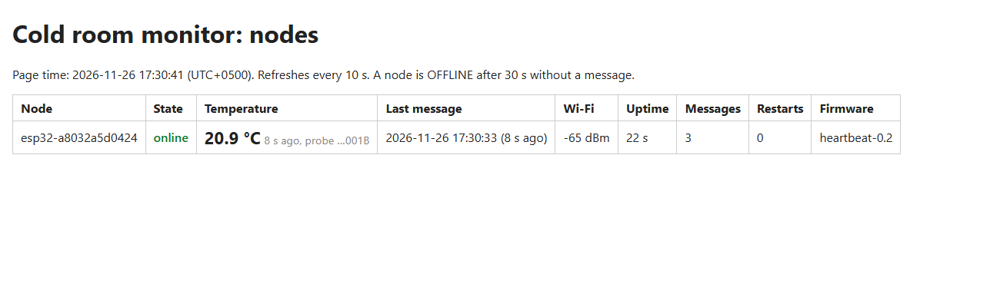

# Cold room monitor for our family fish shop

I'm building a small device that watches the temperature in our shop's cold room and messages my phone when something goes wrong. It is an ESP32 board with a temperature probe, a Telegram bot, and a small program on my laptop that keeps the history.

## Why

My parents run a small fish shop, and all our goods are kept in one cold room. A ready-made monitoring system costs around 500-800 euros, which is too much for us, so my dad drives to the shop every weekend just to check that it's cold.

In November 2026 my parents were away for a week and I had to check the cold room. I went every day, and on the last Sunday I decided to skip it because everything had been fine all week. That was the day it broke down. We found out the next evening and had to throw away about 2000 euros of goods.

It was my fault. I want to make sure it doesn't happen again, and that my parents don't have to spend their weekends driving to look at a thermometer.

## What works right now

- **Temperature probe.** A DS18B20 probe is connected to the ESP32 on my desk and reads the temperature every 10 seconds.
- **Telegram bot.** It runs on the board itself, no computer needed. I can ask it `/status`. If the temperature stays too high or too low for 30 seconds, it sends an alarm and repeats it every 15 seconds until I press "silence". Tested with warm and hot water.
- **Status page.** A small Python program on my laptop stores everything the board sends and shows the latest temperature and whether the board is online (picture above).

Not done yet: nothing is installed in the cold room. The probe is on temporary wiring on a breadboard, and the alarm limits are still test values.

## Next steps

1. Wire the probe properly (with the 4.7 kOhm resistor) and check its accuracy in ice water and in a freezer.
2. Read the settings of the cold room's controller, so I can pick alarm limits that don't go off during every defrost.
3. Put the board in the shop's office and test it in the cold room for 2-3 weeks.

All stages and what "done" means for each: [roadmap](docs/roadmap.md). What I did each day: [project log](docs/project-log.md).

## The cold room

One freezer room of 106 m2, kept at -18 to -20 °C, with one condensing unit, one evaporator and an Elitech ETC-974 controller. I read every nameplate myself: [site survey](docs/site-survey.md), [photos](docs/evidence/README.md).

## Safety

The device only watches. It is never connected to the refrigeration unit's wiring or to mains voltage, and it can't change how the cold room works. If my device breaks, the cold room keeps working as before.

## What's in this repository

| Folder | What it is |
|---|---|
| [`firmware/cold-room-bot`](firmware/cold-room-bot/README.md) | **The main program for the ESP32**: reads the probe and runs the Telegram bot |
| [`server`](server/README.md) | The program on my laptop that stores the data and shows the status page, with its tests |
| [`hardware`](hardware/bench-prototype.md) | Parts list and wiring for the desk build |
| [`docs`](docs/) | My notes: the cold room, the plan, my decisions and why, the project log |
| `firmware/board-check`, `heartbeat`, `bench-test` | Small test programs I wrote on the way (board check, first Wi-Fi messages, first probe test) |

If you only read one thing, read the [project log](docs/project-log.md).

## Author

Aidar Akhmetov
